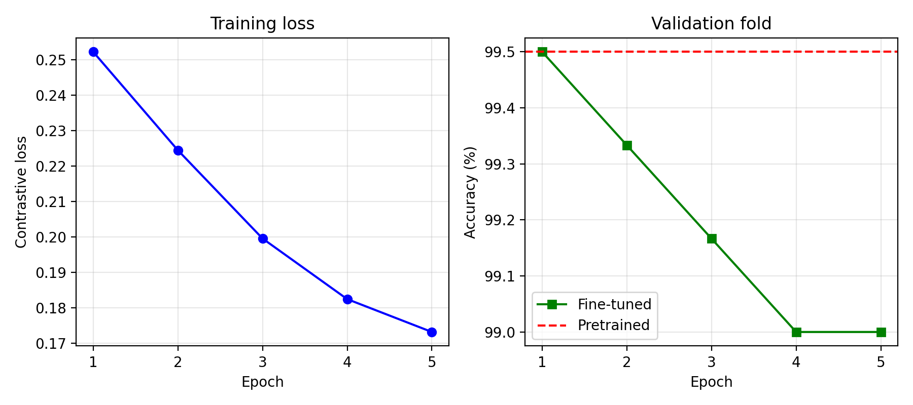

# Face Recognition with FaceNet

This project does face verification (1:1) and face identification (1:N) using FaceNet (InceptionResnetV1), MTCNN and Flask. I evaluated it on the Labeled Faces in the Wild (LFW) benchmark. Faces are turned into 512-dimensional embeddings and compared with Euclidean distance. The project also includes a contrastive-loss fine-tuning experiment and a local web demo where you can upload images and see the recognition results.

## Results

On the standard LFW 10-fold protocol the system reaches 99.30% ± 0.33% accuracy.

| Metric | Value |
|---|---|
| LFW 10-fold accuracy | 99.30% ± 0.33% |
| ROC AUC | 0.9994 |
| FAR / FRR (mean per-fold threshold about 1.08) | 0.53% / 0.87% |
| TAR at FAR = 1% / 0.1% | 99.43% / 98.27% |

### Face selection ablation

Same model, same 6,000 pairs. The only change is how a face is picked when an image has more than one.

| Variant | Face selection | Accuracy | AUC | TAR at FAR = 1% |
|---|---|---|---|---|
| v1 baseline | Largest face (MTCNN default) | 97.18% ± 0.55% | 0.9790 | 95.23% |
| v2 (final) | center_weighted_size | 99.30% ± 0.33% | 0.9994 | 99.43% |

The change adds 2.12 percentage points. I designed the rule after looking at the errors on LFW and then tested it on the same LFW pairs, so the gain is probably a bit optimistic for unseen data.

### Fine-tuning did not help

Fine-tuning with contrastive loss never beat the pretrained model on the validation fold (99.50% pretrained, 99.00% after 5 epochs), so I kept the pretrained weights. On the held-out folds 9 and 10 (1,200 pairs), the pretrained and "fine-tuned" rows are identical (99.67%, FAR 0.50%, FRR 0.17%) because the pretrained weights were the best checkpoint. This 1,200-pair figure should not be compared with the 10-fold result above.



## Features

- Face detection with MTCNN, which returns a 160 x 160 crop.
- Face selection: when several faces are present, center_weighted_size picks the one that ranks best by size and closeness to the image centre.
- Fallback crop: if no face is detected, a centre crop is used. This is not a confirmed detection.
- Embeddings from InceptionResnetV1 pretrained on VGGFace2, L2-normalised to 512 dimensions.
- Verification (1:1): two images are the same person if their distance is below the threshold.
- Identification (1:N): a query is ranked against an enrolled gallery. If no distance is below the threshold, the result is "Unknown".
- Evaluation with the 10-fold LFW protocol: accuracy, FAR, FRR, ROC, AUC and TAR at fixed FAR.
- Fine-tuning with contrastive loss and selective layer unfreezing.
- A Flask web demo with 1:1 verification, 1:N identification with enrolment, and a benchmark dashboard.

## Installation

Python 3.10 is recommended. Newer versions (3.12 and above) failed to build Pillow with facenet-pytorch.

```bash
git clone https://github.com/srividya052/face-recognition.git
cd face-recognition
conda create -n face python=3.10 -y
conda activate face
python -m pip install -r requirements.txt
```

If the requirements file causes problems, this smaller set also works:

```bash
pip install facenet-pytorch scikit-learn matplotlib flask
```

## Usage

Run all commands from the project root with the face environment active.

To evaluate on LFW (the dataset downloads automatically into data/ the first time):

```bash
python -m src.evaluate --folds 10
python -m src.evaluate --folds 2
```

The first command runs the full benchmark and is slow on a CPU. The second is a quick test. Embeddings are cached in results/, so delete the results/lfw_emb_*.npy files after changing the detector, otherwise old numbers get reused.

To fine-tune:

```bash
python -m src.train --epochs 5 --lr 1e-5 --batch_size 32
```

The first run detects faces for all 6,000 pairs and caches them, which takes about 1.8 GB in results/. Training took about one hour on a laptop CPU. Running it again overwrites results/training_curves.png and results/metrics_finetune_comparison.json, so copy them first if you want to keep an earlier run.

To look at the worst same-person pairs:

```bash
python -m src.inspect_errors
```

This reads results/lfw_emb_6000.npy (created by the 10-fold evaluation) and saves results/worst_genuine_pairs.png.

To run the web demo:

```bash
python app/app.py
```

Then open http://127.0.0.1:5050. Keep the server bound to 127.0.0.1 (see the app.run call in app/app.py) so it is not reachable from other machines on your network. If the page looks outdated after a change, restart the server and hard-refresh the browser (Cmd + Shift + R).

The demo has three tabs: 1:1 face verification, 1:N identification with an enrolment gallery (pre-enrolled with eight LFW identities), and a benchmark dashboard. The Load Demo Faces button on the 1:1 tab fills both image slots with sample images so you can try a comparison without uploading anything.

## Project structure

- app/app.py: the Flask web demo
- app/static/: CSS and JavaScript
- app/templates/index.html: the demo page
- src/detect.py: MTCNN detection, face selection and the fallback crop
- src/embed.py: FaceNet embeddings
- src/evaluate.py: 10-fold LFW evaluation
- src/gallery.py: 1:N identification and enrolment
- src/inspect_errors.py: visualises the worst same-person pairs
- src/lfw.py: LFW pairs loader
- src/train.py: contrastive-loss fine-tuning
- results/: metrics and plots (the large caches and model are not included)
- test_images/: sample LFW images used by the demo
- data/: LFW, downloaded automatically (not included)
- requirements.txt

## What is not in this repo

Some large or third-party files are left out on purpose. The code regenerates all of them.

| Not included | Why | How to recreate it |
|---|---|---|
| data/ (the LFW dataset) | Large, and not mine to redistribute | Downloaded automatically the first time you run python -m src.evaluate |
| results/*.npy (embedding and face caches, about 1.7 GB) | Too large for GitHub | Created by python -m src.evaluate --folds 10 and python -m src.train |
| results/model_finetuned.pt (about 107 MB) | Over GitHub's 100 MB file limit | Created by python -m src.train. It holds the pretrained weights anyway |

The images in test_images/ are a small set of LFW photos used for demonstration only. The metrics and plots in results/ come from runs on my machine, so run the evaluation yourself if you want to reproduce them.

## How it works

1. Detect: MTCNN (image_size=160, margin=20, keep_all=False, selection_method="center_weighted_size") returns one face crop.
2. Embed: InceptionResnetV1 with VGGFace2 weights maps the crop to a 512-dimensional vector, which is L2-normalised.
3. Compare: the Euclidean distance between two embeddings. Smaller means more similar.
4. Decide: a distance below 1.08 means the same person. For identification, the nearest enrolled identity is returned only if its distance is below 1.08.

The percentage shown next to each match in the demo is a similarity score derived from the distance. It is not a probability.

## Evaluation protocol

LFW's 6,000 pairs are split into 10 folds of 600 pairs. For each fold, the threshold is chosen on the other nine folds and applied to the held-out fold, so it is never tuned on the data it is scored on. The reported accuracy is the mean over the folds, with its standard deviation.

- FAR is the share of different-person pairs wrongly accepted.
- FRR is the share of same-person pairs wrongly rejected.
- TAR is 1 minus FRR at a fixed FAR.

The mean threshold across folds was 1.0825, and the demo uses 1.08.

## Fine-tuning details

To avoid overlap between training and test data, the split follows the 10 folds of pairs.txt, whose identities are separate across folds.

| Split | LFW folds | Pairs |
|---|---|---|
| Training | 1 to 7 | 4,200 |
| Validation (best epoch and threshold) | 8 | 600 |
| Final test | 9 and 10 | 1,200 |

Settings: contrastive loss (margin 1.0), AdamW, learning rate 1e-5, weight decay 1e-4, cosine annealing, batch size 32, 5 epochs and horizontal-flip augmentation. By default only block8, avgpool_1a, last_linear and last_bn are trainable (about 2.5M parameters). The --unfreeze_all flag trains the whole network.

The best checkpoint is chosen on the validation fold, and the pretrained weights are kept unless a fine-tuned epoch is strictly better. The threshold for this comparison is also chosen on the validation fold (1.065), so it differs slightly from the 10-fold mean of 1.0825.

Validation accuracy per epoch was 99.50% (pretrained), then 99.50%, 99.33%, 99.17%, 99.00% and 99.00%. Training loss fell from 0.2522 to 0.1731 over the same epochs, which is consistent with overfitting, although I did not test that directly. Because no epoch beat the pretrained model, results/model_finetuned.pt contains the pretrained weights.

Training is not seeded, so repeated runs differ slightly (an earlier identical run ended at 98.83% instead of 99.00%). On a 600-pair validation fold, one pair is 0.17 percentage points, so these differences are within noise. The consistent finding is that no epoch improved on the pretrained model.

## Demo test results

These were measured in the web demo at threshold 1.08, using LFW images.

| Mode | Test | Result | Distance |
|---|---|---|---|
| 1:N | Enrolled photo of Colin Powell | Identified: Colin Powell | 0.000 (same image as the gallery entry, a sanity check) |
| 1:N | Different photo of Colin Powell | Identified: Colin Powell | 0.518 (cosine 0.866) |
| 1:N | Arnold Schwarzenegger (not enrolled) | Unknown person | nearest 1.274 (Tony Blair) |
| 1:N | Image with no face | No face detected, no crash | n/a |
| 1:1 | Colin Powell, two different photos | Same person | 0.518 (cosine 0.8658) |
| 1:1 | Arnold Schwarzenegger vs Colin Powell | Different people | 1.3312 (cosine 0.114) |
| 1:1 | George W. Bush vs Colin Powell | Different people | 1.3541 (cosine 0.0831) |

A comparison takes about 0.2 seconds on a laptop CPU. The first request after startup is slower.

## Limitations

- LFW is nearly saturated. Scores above 99% leave little room to show differences, and cross-pose, cross-age and low-resolution benchmarks would be more informative.
- The face-selection rule was designed on LFW errors and evaluated on LFW, so the gain is likely optimistic. It suits portrait-style photos and may fail when the subject is off-centre.
- The demo gallery has only eight identities. Identification at a realistic scale is untested, and the risk of false accepts grows with gallery size.
- The fallback centre crop does not prove that a face is present.
- LFW and VGGFace2 are skewed toward certain demographics and public figures. I did not measure error rates across groups.
- There is no liveness detection, so a printed photo or a screen replay can fool the system. It is not suitable for security-critical authentication.
- One global threshold is a trade-off. An application should choose its operating point from the FAR it can accept.
- The error analysis reads only the cached embeddings, so it describes the worst pairs under the final detector and says nothing about the earlier baseline.
- The fine-tuning comparison uses a small 1,200-pair test set with only a handful of errors, so its numbers are coarse.

## Ethics and privacy

Face images and embeddings are biometric data. A deployed system would need informed consent for enrolment, secure storage of embeddings, a retention policy and a way to remove people. Automated identification should not be used for surveillance or high-stakes decisions without human review and bias auditing. This project uses publicly available research images, and the demo runs only on the local machine.

## Future work

- Fine-tune with an ArcFace-style loss on a larger multi-image dataset such as CelebA.
- Try --unfreeze_all with a much smaller learning rate, and seed the training so runs are repeatable.
- Evaluate the face-selection rule on a separate dataset.
- Test on cross-pose and low-quality benchmarks.
- Add liveness detection.
- Measure error rates across demographic groups.

## Acknowledgements and references

Face detection and the pretrained VGGFace2 FaceNet weights come from the open-source facenet-pytorch library by Tim Esler (https://github.com/timesler/facenet-pytorch). The project also uses PyTorch, scikit-learn and Flask. I used AI coding assistants during development, and I ran all the experiments and checked the results myself.

1. Schroff, F., Kalenichenko, D., Philbin, J. FaceNet: A Unified Embedding for Face Recognition and Clustering. CVPR 2015.
2. Huang, G. B., Ramesh, M., Berg, T., Learned-Miller, E. Labeled Faces in the Wild. UMass Amherst Technical Report 07-49, 2007. LFW is downloaded by the code and is not redistributed in this repo.
3. Zhang, K., Zhang, Z., Li, Z., Qiao, Y. Joint Face Detection and Alignment using Multi-task Cascaded Convolutional Networks. IEEE Signal Processing Letters, 2016.
4. Cao, Q., Shen, L., Xie, W., Parkhi, O. M., Zisserman, A. VGGFace2: A Dataset for Recognising Faces across Pose and Age. FG 2018.
5. Deng, J., Guo, J., Xue, N., Zafeiriou, S. ArcFace: Additive Angular Margin Loss for Deep Face Recognition. CVPR 2019.

## Author

Srividya Mallavarapu (https://github.com/srividya052)
